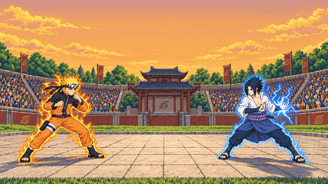
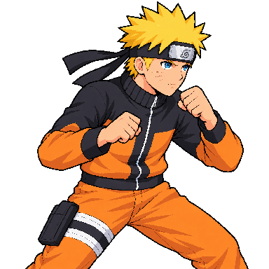
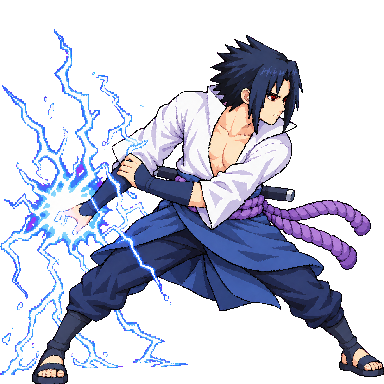
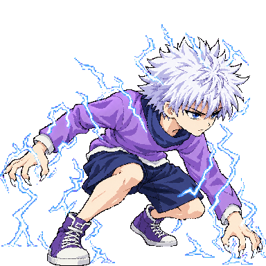

# GCD Tourney

**A browser-based HD-2D anime arena fighter with online play, built on Three.js.**

**[Play it in your browser](https://gcd-tourney.vercel.app)** on a computer, a gamepad or a phone (landscape). No install or sign-up.

<a href="https://gcd-tourney.vercel.app"></a>

Pixel-art fighters battle inside a real 3D tournament arena with a cinematic camera, auras, super flashes and rhythm-based ultimate clashes. It plays like a modern anime fighter: combos, parries, dodges, throws, beam clashes and a CPU you can set anywhere from Easy to Impossible. You can also open an online room and send friends the link.

> A personal, non-commercial fan project. The fighters are characters from existing anime series and belong to their rights holders (see [the note at the end](#a-note-on-the-characters)).

## Fighters

<table>
<tr>
<td width="25%" align="center"><br><b>Naruto</b><br><sub>Rasengan, Shadow Clones, Nine-Tails Cloak</sub></td>
<td width="25%" align="center"><br><b>Sasuke</b><br><sub>Chidori, Kirin, Amaterasu</sub></td>
<td width="25%" align="center"><br><b>Killua</b><br><sub>Godspeed, Narukami, Whirlwind</sub></td>
<td width="25%" align="center"><br><b>Gojo</b><br><sub>Infinity, Blue, Red, Hollow Purple</sub></td>
</tr>
</table>

Goku and Luffy are also playable. Every fighter shares one baseline kit (directional specials, a second super and an ultimate), and each has its own signature mechanics.

## Highlights

- **Online play with rollback netcode.** Players create public or private rooms and share an invite link or a five-letter code. Winner stays on, everyone else spectates live, and a dropped connection gets 20 seconds to rejoin.
- **A deterministic simulation.** The game runs on a fixed 60 Hz step, so both players' machines compute the same match. A build-time lint blocks floating-point math calls that differ between browser engines, and recorded matches replay frame for frame as regression tests.
- **Per-frame hitboxes.** A hit lands only where the fist or foot on the current sprite frame overlaps the opponent's body.
- **CPU opponents with real tiers.** The top level reads frame data, parries, punishes and composes new combos every match. A spectator-only "God" level shows off the whole engine.
- **Beam and melee clashes.** When two ultimates collide, both players play a short rhythm chart and the better timing wins.
- **Runs anywhere.** Keyboard, PlayStation or Xbox pads with rebinding, and an on-screen touch layout for phones.
- **No asset files for sound.** All music and sound effects are synthesized live with WebAudio.

## Security and abuse prevention

The online lobby is designed so a public game can't easily be abused:

- **Bot protection:** rooms are gated by Cloudflare Turnstile.
- **Origin allowlist:** WebSocket upgrades are accepted only from the game's own origins.
- **No free-text chat:** players communicate with fixed quick-chat lines and emotes only, which removes the main harassment vector.
- **Moderation:** nicknames pass a word filter. A room host can remove someone, and players can vote to remove someone.
- **Isolation:** each room is its own Cloudflare Durable Object, and the room rules live in plain JavaScript with a fake-clock test suite.
- **No secrets in the repo:** server secrets live in Cloudflare's secret store.

## How it's built

| Layer | Technology |
|---|---|
| Rendering | Three.js, rendered at about 360p and upscaled nearest-neighbor so geometry and sprites share one pixel grid, with bloom and a color grade on top |
| Build | Vite, plain JavaScript ES modules, no other runtime dependencies |
| Online | Cloudflare Workers and Durable Objects (one per room), WebSockets, rollback netcode |
| Audio | WebAudio synthesis (music, sound effects, crowd) |
| Hosting | Vercel (game) and Cloudflare (lobby) |

```
src/
  core/        renderer, input (keyboard, gamepad, touch), synthesized audio
  game/        match loop, fighter state machine, move and frame data, CPU AI, projectiles, clashes, camera
  characters/  one data file per fighter
  art/rig/     3D rig that bakes placeholder sprites for any fighter without finished art
  world/       arena, crowd, stages, announcer
  ui/          HUD, menus, controls and rebinding
server/        online lobby (Cloudflare Worker + Durable Objects)
tools/         sprite packer, lints and merge guards
docs/          architecture, combat design and 55 architecture decision records
```

More detail is in [docs/ARCHITECTURE.md](docs/ARCHITECTURE.md), [docs/COMBAT_DESIGN.md](docs/COMBAT_DESIGN.md) and [docs/decisions/](docs/decisions/README.md).

## Built with AI agents, with a human approval gate

I built this project with AI coding agents as a deliberate experiment in running them safely on a long-lived codebase:

- **Separate roles.** Claude Code owns engine and gameplay code. Codex produces the sprite art. I own design and every approval.
- **Human review of every AI-generated image.** Each generated asset is versioned and never overwritten, then logged in a review queue. It ships only after I approve it.
- **Enforced in tooling, not just in policy.** A merge guard refuses any branch whose packed art isn't the approved version, and every feature lands through a pull request.
- **Recorded decisions.** Architecture choices are written up as ADRs, so the agents and I don't relitigate them.

## Run it locally

```bash
npm install
npm run dev        # http://127.0.0.1:5188
npm run build      # production build into dist/
```

| Guide | What's in it |
|---|---|
| [docs/PLAYING.md](docs/PLAYING.md) | every mode, full controls, the combat toolkit and each fighter's moves |
| [docs/DEVELOPMENT.md](docs/DEVELOPMENT.md) | commands, debug URLs and tests |
| [docs/TESTING.md](docs/TESTING.md) | test checklists and the CPU-vs-CPU soak test |
| [CHANGELOG.md](CHANGELOG.md) | what changed in each version |

## A note on the characters

This is a personal, non-commercial portfolio project. Naruto, Sasuke, Killua, Gojo, Goku and Luffy, and their techniques, belong to their creators and rights holders (Shueisha and the studios behind *Naruto*, *Hunter x Hunter*, *Jujutsu Kaisen*, *Dragon Ball* and *One Piece*). This project is not affiliated with or endorsed by any of them. A public or commercial release would use original characters.
