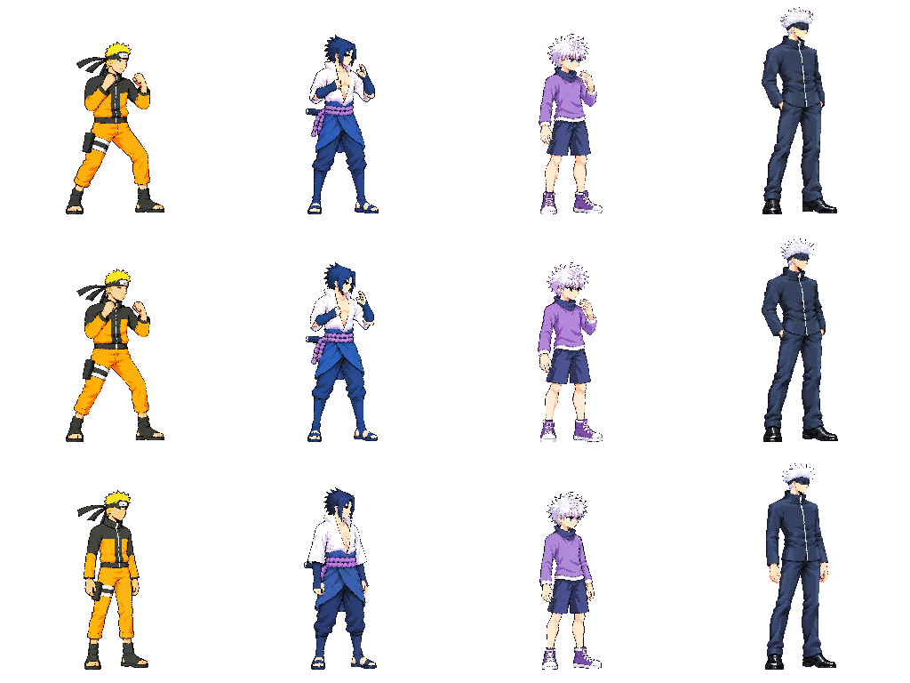

# Candidate idle comparison v01

Derived QA snapshot, not newly approved artwork or a passing full-cast atlas. Columns: Naruto, Sasuke, Killua, Gojo. Rows: candidate idle frame0, candidate idle frame4, approved upright neutral. Candidate versions are Naruto5, Sasuke6, Killua3, Gojo4. The JSON records exact source paths, hashes, head targets and placement bounds.

The diagnostic uses current source skull-to-chin sidecars unchanged and approved neutral skull-to-sole factors at the common cast scale. It reconstructs cells using the packer helpers, without changing any worker input or production atlas. Automatic palette/head-gate results are not inferred from this image.

The corrected working anchors broadly preserve the approved relationship: Gojo is substantially taller with a lean adult body; Naruto and Sasuke have similar teenage builds; Killua is shorter with distinctive hair mass. Combat stances bend knees and widen feet, so comparing bounding-box height alone would give the wrong answer. Naruto and Sasuke's torso and leg lengths look closer to their neutrals than the earlier compressed candidates. Killua's longer shins carry the documented landmark uncertainty. Gojo's B segment sits several pixels lower than A; review the complete loop for that transition.

This supports continuing QA against these anchors. It does not approve them, certify every joint or resolve Sasuke's palette-probe failure. Every animation still requires its own gate, frame/loop review and user decision.
